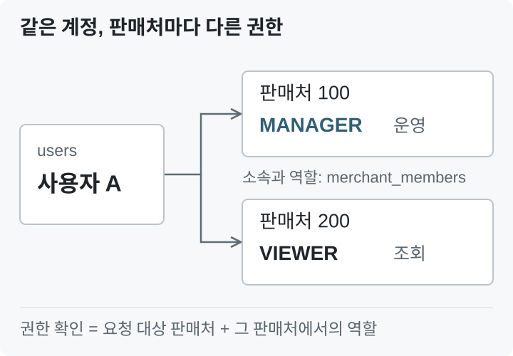
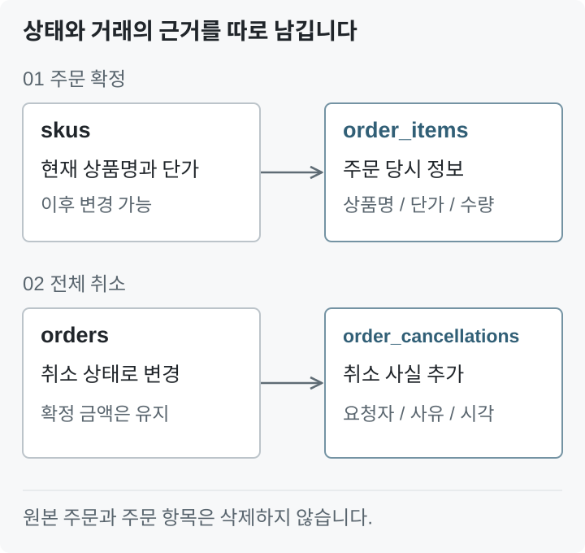
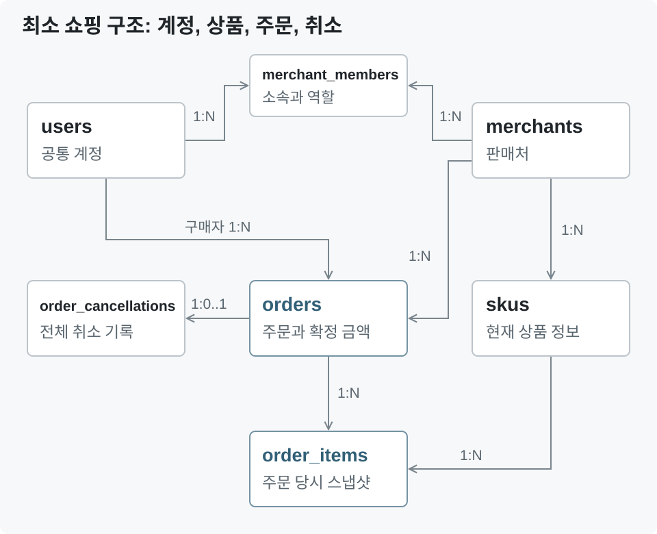

## 프로모션 검증을 위한 최소 DB 구조 설계

먼저 프로모션을 검증할 수 있도록 최소한의 쇼핑 기능을 지원하는 DB 구조를 설계하기로 했다.

쇼핑몰 전체를 구현하는 것이 목적은 아니다. 상품을 선택하고, 주문 당시의 가격을 기록하며, 주문을 전체 취소할 수 있는 구조가 우선 필요했다. 이후 이 흐름에 행사와 쿠폰, 할인 비용 기록을 연결하려고 한다.

요구사항을 읽고 우선 추출한 엔터티는 다음과 같다.

- 판매처
- 담당자
- 구매자
- 상품
- 주문 기록
- 취소 기록

다만 추출한 엔터티를 그대로 하나씩 테이블로 만들지는 않았다. 공통으로 관리할 정보와 별도로 표현해야 할 관계를 구분하고, **현재 상태뿐 아니라 어떤 과정을 거쳐 그 상태가 되었는지 남겨야 할 부분**도 함께 살펴봤다.

### 업무 경험에서 배운 이력의 중요성

이력을 처음부터 고려하려는 이유는 실제 업무에서 겪었던 경험 때문이다.

고객은 현재 데이터를 조회하는 것뿐 아니라, 특정 작업이 언제 이루어졌는지, 누가 처리했는지, 어떤 내용이 변경됐는지를 확인할 수 있는 자료를 요청하기도 했다. 이때 필요한 것은 단순한 현재 상태가 아니라 처리 과정을 설명할 수 있는 기록이었다.

하지만 해당 이력이 충분히 남아 있지 않으면 여러 테이블을 조인해 당시 상황을 재구성해야 했다. 조회 조건과 쿼리가 복잡해졌고, 성능 문제를 해결하기 위한 튜닝도 필요했다. 그마저도 기록하지 않은 정보까지 복원할 수는 없다는 한계가 있었다.

이후 UAT 과정에서 히스토리 테이블을 추가하는 작업도 쉽지 않았다. 테이블만 만드는 것으로 끝나는 것이 아니라, 기존 처리 흐름에서 어느 시점에 어떤 정보를 기록해야 하는지 다시 살펴봐야 했기 때문이다.

이 경험을 통해 **이력은 문제가 생긴 뒤 추가하는 조회 편의 기능이 아니라, 중요한 업무 처리를 설명하기 위한 데이터**라는 생각을 갖게 됐다.

그렇다고 모든 테이블의 변경 내용을 무조건 복제하려는 것은 아니다. 이번에는 주문 확정, 취소, 행사 공개와 중단처럼 업무적으로 의미 있는 시점을 먼저 정하고, 각 시점에 무엇을 남겨야 하는지 설계하려고 한다.

### 담당자와 구매자는 같은 계정 구조를 사용한다

담당자와 구매자는 모두 로그인 아이디와 비밀번호를 가진 사용자다. 따라서 각각의 계정 테이블을 만드는 대신, 공통 정보는 `users`에서 관리하기로 했다.

차이는 판매처 소속과 권한에 있다. 일반 구매자에게는 판매처 소속이 필요하지 않지만, 담당자는 어느 판매처에 속하며 어떤 작업을 수행할 수 있는지 구분해야 한다.

처음에는 `users`에 `merchant_id`와 `merchant_role`을 직접 저장하는 방식을 생각했다. 담당자가 판매처 하나에만 소속된다면 이 구조로도 충분하다. 판매처에 담당자가 여러 명이더라도 여러 사용자 행에 같은 `merchant_id`를 저장하면 된다.

즉, **담당자가 여러 명이라는 이유만으로 별도 테이블이 필요한 것은 아니다.**

다만 여기서 계정 자체의 역할과 특정 판매처에서의 역할을 같은 위치에 저장해도 되는지 고민하게 됐다.

### 로그인한 사람과 업무 대상 조직을 구분한다

이 부분에서도 실제 업무 경험이 떠올랐다.

업무에서는 세무 업무 담당자나 대리인이 자신의 계정으로 로그인한 뒤, 신고 대상 기업으로 업무 대상을 전환하고 세무신고를 진행하는 흐름이 있었다. 당시에는 이를 세션 전환이라고 불렀다.

이 흐름에서는 로그인한 사람이 누구인지와, 현재 어느 기업을 대상으로 어떤 자격으로 업무를 수행하는지가 구분되어 있었다.

사용자와 기업의 관계를 `Relation ID`로 식별해 관리했던 것으로 기억한다. 세부 구현을 그대로 가져오려는 것은 아니지만, **계정과 조직 사이의 관계 자체가 별도의 의미를 가진다**는 점이 이번 설계와 연결됐다.

프로모션 서비스에서도 마찬가지다. 같은 계정이라도 어느 판매처를 대상으로 작업하는지에 따라 허용되는 행동이 달라질 수 있다.

따라서 다음 세 가지를 나누어 생각했다.

| 구분 | 확인할 내용 |
|---|---|
| 계정 | 로그인한 사용자는 누구인가? |
| 업무 대상 | 어느 판매처의 데이터를 다루는가? |
| 관계와 권한 | 해당 사용자가 그 판매처에서 이 작업을 수행할 수 있는가? |

화면에서 판매처를 선택하거나 세션에 판매처 식별자를 저장하는 것만으로 권한이 생기는 것은 아니다. 서버에서는 요청 대상 판매처와 사용자의 소속 관계를 확인해야 한다.

또한 변경 이력에는 판매처만 남기는 것이 아니라 **실제로 작업한 사용자도 함께 기록**해야 한다. 그래야 어느 판매처에서 누가 작업했는지 추적할 수 있다.

### 계정과 판매처 소속을 분리한다

이러한 판단을 바탕으로 계정 정보와 판매처 소속 정보를 분리했다.

| 테이블 | 표현하는 개념 | 주요 정보 |
|---|---|---|
| `users` | 누구인가? | 로그인 아이디, 비밀번호 해시, 사용자 이름 |
| `merchants` | 어떤 판매처인가? | 판매처 이름 |
| `merchant_members` | 누가 어느 판매처에서 어떤 권한을 갖는가? | 사용자, 판매처, 담당자 역할 |

`merchant_members`는 담당자의 계정을 별도로 만드는 테이블이 아니다. `users`에 있는 계정과 판매처를 연결하고, 해당 관계에서의 권한을 저장하는 테이블이다.

이렇게 분리하면 담당자의 판매처 소속을 해제하더라도 계정과 구매 이력을 유지할 수 있다. 일반 구매자의 계정에는 판매처 관련 컬럼을 비워 둘 필요도 없다.

조회 시 조인이 추가되지만, **계정과 소속이라는 서로 다른 개념을 명확하게 표현하는 편을 선택했다.**

### 복수 판매처 소속을 표현할 수 있도록 설계한다

요구사항에는 담당자가 하나의 판매처에만 소속되어야 하는지, 여러 판매처에 소속될 수 있는지가 명시되어 있지 않았다.

처음에는 하나의 판매처에만 소속되는 것으로 제한하려고 했다. 하지만 소속 관계를 별도 테이블로 분리하면서, 향후 소속 정책이 달라지더라도 대응할 수 있도록 계정 하나가 여러 판매처에 연결될 수 있는 구조로 설계했다.

**이는 원래 요구사항에 명시된 기능이 아니라, 설계 과정에서 추가한 확장 가능성이다.** 복수 소속을 관리하는 별도 화면까지 먼저 구현하는 것은 아니며, 현재 데이터 모델에서 이를 제한하지 않는 수준으로 반영한다.

`merchant_members`의 기본 구조는 다음과 같다.

| 컬럼 | 역할 |
|---|---|
| `merchant_id` | 소속 판매처 |
| `user_id` | 담당자 계정 |
| `role` | 해당 판매처에서의 역할 |
| `created_at` | 소속 등록 시각 |

`(merchant_id, user_id)`를 복합 기본 키로 사용해 같은 계정이 같은 판매처에 중복 등록되는 것을 방지한다. `user_id` 단독으로는 유일성 제약을 두지 않는다.

예를 들면 다음 관계를 표현할 수 있다.

| 사용자 | 판매처 | 역할 |
|---|---|---|
| 사용자 A | 판매처 100 | `MANAGER` |
| 사용자 A | 판매처 200 | `VIEWER` |
| 사용자 B | 판매처 100 | `VIEWER` |

사용자 A는 판매처 100에서는 행사를 운영할 수 있지만, 판매처 200에서는 조회만 할 수 있다. 따라서 권한 검사에서는 계정의 역할 하나가 아니라 **요청 대상 판매처와 연결된 소속 관계의 역할**을 확인한다.

### 역할은 별도 테이블로 분리하지 않는다

제안요청서에는 판매자의 조회 권한과 운영 권한을 구분하라는 내용이 있다. 이를 구현하기 위해 두 가지 역할을 정의했다.

| 역할 | 허용할 작업 |
|---|---|
| `VIEWER` | 소속 판매처의 행사와 할인 비용 등 조회 |
| `MANAGER` | 조회와 행사 생성, 수정, 공개, 중단 |

권한을 구분하는 것은 요구사항이지만, `VIEWER`와 `MANAGER`라는 이름과 구체적인 작업별 매핑은 구현을 위한 설계다.

현재 요구사항에는 판매처가 직접 역할을 만들거나 권한 조합을 수정하는 기능이 없다. 따라서 `roles`, `permissions` 같은 테이블을 추가하지 않고 `merchant_members.role`에 고정된 역할을 저장하기로 했다.

**역할은 수행 가능한 작업을 결정하고, 판매처 소속은 접근 가능한 데이터의 범위를 결정한다.** 관리 역할을 가진 계정이라고 해서 모든 판매처의 데이터를 수정할 수 있는 것은 아니다.

실제 업무에서 계정의 역할과 조직 안에서의 역할을 구분했다고 해서 그 구조 전체를 이번 프로젝트에 가져올 필요는 없다. 현재 필요한 판매처별 권한부터 구현하고, 플랫폼 감사 권한은 접근 범위가 다르므로 감사 기능을 설계할 때 별도로 다룰 예정이다.

### 운영 규모와 업무 규칙을 구분한다

보충자료에는 판매처당 담당자 최대 5명이라는 조건이 있었다. 처음에는 이를 담당자 등록 제한으로 해석했지만, 해당 내용은 운영 규모에 제시되어 있었다.

이 조건만으로 여섯 번째 담당자의 등록을 차단하는 기능까지 요구됐다고 단정할 수는 없다. 따라서 현재는 테스트 데이터를 구성하는 기준으로 사용하고, 별도의 인원 제한 기능은 추가하지 않기로 했다.

요구사항을 바탕으로 개발하려는 만큼, **명시된 기능과 설계 과정에서 추가한 판단을 구분해 기록할 필요가 있었다.**

### 상품은 구매 가능한 SKU 단위로 관리한다

상품은 실제로 주문할 수 있는 단위인 SKU로 관리한다.

예를 들어 `기본 티셔츠 / 검정 / M`과 `기본 티셔츠 / 검정 / L`은 서로 다른 SKU다. 현재는 상품과 옵션을 여러 테이블로 분리하지 않고, 옵션을 포함한 표시명과 판매 가격을 `skus`에 저장한다.

상품 카탈로그나 범용 옵션 관리 기능을 만드는 것이 목적은 아니다. **프로모션 적용 대상을 식별하고 주문에 포함할 수 있는 수준**으로 범위를 제한했다.

재고 수량도 초기 구조에는 포함하지 않는다. SKU를 식별하는 것과 재고를 예약하거나 차감하는 것은 별개의 기능이며, 현재 구현 범위에는 재고 처리가 포함되지 않는다.

### 주문과 주문 항목을 분리한다

주문 한 건에는 여러 SKU가 포함될 수 있다. 따라서 주문 전체 정보는 `orders`, 구매한 상품 목록은 `order_items`에 저장한다.

| 테이블 | 주요 정보 |
|---|---|
| `orders` | 구매자, 판매처, 주문 상태, 상품 합계, 배송비, 할인액, 최종 금액 |
| `order_items` | 구매한 SKU, 수량, 주문 당시 상품명과 단가 |

한 주문은 하나의 판매처에 속하도록 한다. 다른 판매처의 상품은 같은 주문에 포함하지 않는다.

상품명과 가격은 `skus`에도 있지만, 주문 항목에 다시 저장한다. 현재 상품 정보를 참조하는 것만으로는 과거 거래를 정확하게 보존할 수 없기 때문이다.

주문 이후 상품 가격이나 이름이 변경되더라도 과거 주문의 내용은 바뀌지 않아야 한다. 따라서 이 중복은 **현재 상태와 거래 당시의 사실을 구분하기 위한 저장**이다.

실제 결제는 구현하지 않으므로 주문 상태도 모의 주문 확정과 전체 취소를 표현하는 수준으로 제한한다.

### 주문 스냅샷과 감사 이력은 구분한다

이력을 중요하게 생각하다 보니 `order_items`에도 별도의 히스토리 테이블이 필요한지 고민했다.

다만 주문 당시의 상품명과 단가를 보존하는 것과, 누가 어떤 작업을 수행했는지 기록하는 것은 목적이 다르다.

| 구분 | 확인하려는 내용 | 기록 방식 |
|---|---|---|
| 주문 당시 정보 | 어떤 상품을 몇 개, 얼마에 구매했는가? | `order_items`의 스냅샷 |
| 취소 사실 | 누가 언제 어떤 사유로 취소했는가? | `order_cancellations` |
| 주요 업무의 실행 이력 | 누가 어떤 작업을 시도했고 결과가 무엇이었는가? | 감사 기록 |

현재는 주문 확정 이후 상품이나 수량을 수정하는 기능이 없다. 따라서 **확정된 주문 항목은 변경하지 않는 것을 원칙**으로 하고, 전체 취소는 별도 기록으로 표현하기로 했다.

이 조건에서는 주문 항목을 그대로 복제하는 히스토리 테이블을 먼저 추가할 필요는 없다고 판단했다. 대신 주문 확정과 취소 같은 주요 작업의 실행자와 처리 결과를 추적할 수 있도록 감사 기록의 범위를 정하려고 한다.

과거 업무에서 이력이 부족해 어려움을 겪었다는 이유로 모든 데이터를 중복 저장하기보다는, **무엇을 설명하기 위해 어떤 기록이 필요한지 먼저 구분하는 것**이 중요하다고 생각했다.

### 취소는 원본 주문을 삭제하지 않는다

전체 취소는 주문을 없애는 것이 아니라, 이미 발생한 주문이 취소됐다는 사실을 기록하는 처리다.

주문 상태는 `orders`에서 변경하고, 취소 요청자와 사유, 처리 시각은 `order_cancellations`에 저장한다. 전체 취소만 지원하므로 주문당 취소 기록은 하나만 허용한다.

원본 주문과 주문 항목은 삭제하지 않는다. 확정된 주문 금액도 0으로 덮어쓰지 않는다.

이후 할인 기능을 연결할 때도 기존 할인 비용 기록을 지우는 대신, 취소에 따른 비용 복원 기록을 추가할 계획이다. 그래야 비용이 발생한 시점과 취소된 시점을 각각 확인할 수 있다.

이는 단순히 현재 순부담이 얼마인지 조회하는 것과는 다르다. **어떤 거래가 발생했고, 이후 어떤 처리로 현재 결과가 되었는지 설명할 수 있어야 한다.**

### 최소 업무 테이블 정리

이러한 판단을 바탕으로 핵심 업무 테이블을 일곱 개로 정리했다.

| 테이블 | 역할 |
|---|---|
| `users` | 구매자와 담당자의 계정 정보 |
| `merchants` | 판매처 정보 |
| `merchant_members` | 담당자의 판매처 소속과 역할 |
| `skus` | 구매 가능한 상품 정보 |
| `orders` | 주문 전체 정보와 확정 금액 |
| `order_items` | 구매 상품, 수량, 주문 당시 정보 |
| `order_cancellations` | 전체 취소 기록 |

[관계도 크게 보기](https://hyunmyungchoi.github.io/media/src/content/images/promotion-1-erd.svg)

이 목록은 최소 쇼핑 흐름을 위한 업무 테이블이다. 요청 재시도를 처리할 멱등성 정보와 프로모션·감사 관련 테이블은 각 처리 흐름을 구체화하면서 추가하려고 한다. 다만 어떤 작업의 실행자, 시각, 변경 내용과 결과를 남길지는 해당 기능을 구현할 때부터 함께 정할 계획이다.

최소 구조를 만든다는 것이 무조건 테이블 수를 줄이는 것은 아니라고 생각했다. **현재 필요하지 않은 기능은 제외하되, 서로 다른 개념과 거래의 근거는 구분해서 남기는 것**을 기준으로 삼았다.

실제 업무에서 겪었던 문제를 그대로 재현하거나 복잡한 구조를 가져오는 것이 아니라, 그 경험에서 필요한 판단 기준을 가져오고 싶었다. 계정과 소속을 구분하고, 현재 상태와 처리 이력을 구분한 것도 그 과정의 일부다.

먼저 이 구조로 할인 없는 모의 주문과 전체 취소를 구현하고, 이후 행사와 쿠폰, 할인 비용 기록을 연결해 프로모션의 처리 규칙을 검증할 계획이다.
