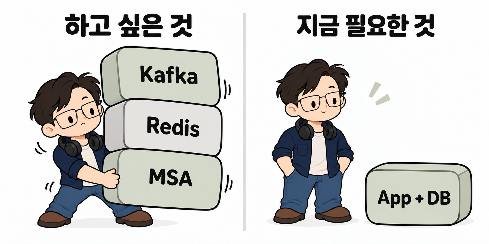

## 이번에는 기술보다 요구사항부터

사이드 프로젝트를 시작하면 무엇을 만들지보다 무엇을 쓸지 먼저 고민하게 된다. 기술 목록은 금방 채워지는데, 정작 그 기술로 해결할 문제는 흐릿한 경우가 있었다.

이번에는 순서를 바꿔 보기로 했다. **요구사항부터 읽고, 필요한 기술은 그다음에 고르자.**

GPT에게 개인 프로젝트용 가상 요구사항을 만들어 달라고 요청했다. 주제는 판매자가 할인 행사를 운영하는 **프로모션 서비스**다.

프로모션을 고른 데는 **실제 업무에서 세율을 적용하는 과정을 살펴본 경험이 영향을 줬다.** 숫자에 비율을 곱하는 계산 자체보다, 어떤 조건에서 누구에게 적용하고 결과를 어떻게 관리할지가 더 복잡했다.

그런 특성을 사이드 프로젝트에서도 다뤄 보고 싶었다. 다만 세금 시스템은 전문 지식과 범위의 부담이 컸다. 할인 조건과 비용 부담, 행사 중단과 주문 취소를 함께 고민할 수 있는 프로모션으로 방향을 잡았다.

## 쿠폰 하나인데, 생각할 게 왜 이렇게 많지?

요구사항의 목적은 다음과 같다.

> 판매자가 할인 행사를 설정할 때 고객의 최종 가격과 본인의 할인 부담을 미리 파악하고, 행사 중단과 주문 취소의 영향을 일관되게 관리하도록 지원한다.

할인율을 입력하고 최종 가격을 보여 주면 되는 것처럼 보인다. 그런데 주문과 취소를 붙이는 순간 질문이 늘어난다.

- 같은 쿠폰을 두 주문에서 동시에 사용하면 어떻게 막을까?
- 취소 요청이 두 번 들어오면 할인 비용도 두 번 되돌려야 할까?
- 행사를 중단하면 이미 발급한 쿠폰은 어떻게 해야 할까?
- 판매자라는 이유만으로 다른 판매처의 행사까지 수정할 수 있어도 될까?

쿠폰은 하나인데 확인할 것은 하나가 아니었다.

필요한 것은 가격 계산 화면만이 아니었다. **중복 요청에도 결과가 한 번만 반영되고, 주문, 쿠폰, 할인 비용이 서로 어긋나지 않는 흐름**을 만들어야 했다.

## 쿠폰을 붙일 작은 쇼핑 기능부터

쿠폰을 적용하려면 우선 적용할 상품과 주문이 있어야 한다. 쿠폰 기능만 따로 만들어서는 할인 전후 금액이 맞는지, 주문을 취소했을 때 비용이 제대로 반영되는지 끝까지 확인하기 어렵다.

그래서 **요구사항을 적용하고 검증할 수 있는 작은 쇼핑 기능부터 만들어 볼 계획**이다. 먼저 다음 흐름을 연결하려고 한다.

1. 준비된 상품 데이터를 목록과 상세 화면에서 확인한다.
2. 상품과 수량을 선택하고 주문 금액을 확인한다.
3. 실제 결제 없이 모의 주문을 만들고, 주문 내역을 조회하거나 전체 취소한다.

이 흐름 위에 쿠폰 발급, 할인 미리보기, 주문 적용과 취소 시 할인 비용 반영을 차례로 붙이려고 한다. 할인 전의 기본 흐름과 쿠폰을 적용한 흐름을 같은 주문 기준으로 비교할 수 있게 만드는 것이다.

쇼핑몰 전체를 만드는 것은 아니다. 회원가입, 실제 결제, 재고 예약은 범위에서 제외하고, 요구사항에 따라 준비된 가상 계정과 상품 데이터를 사용한다.

## C#도 검토했는데, 왜 다시 Java인가

실행 환경은 VMware의 **VM 1대, 2 vCPU, RAM 4GB**로 정했다.

VMware는 이전에 VirtualBox에서 겪었던 VM 멈춤과 성능 문제가 VMware로 옮긴 뒤 해소됐던 경험이 있어 이번에도 사용하기로 했다.

VM 한 대에 2 vCPU와 4GB를 할당한 것은 **작은 환경에서 먼저 구현하고, 같은 자원 조건에서 성능과 병목을 검증하기 위한 실험 조건**이다. 처음부터 자원을 늘리기보다, 이 조건에서 요구사항을 어디까지 충족하는지 확인한 뒤 증설이나 구성 변경의 필요성을 판단하려고 한다. 측정 결과로 정한 운영 적정 사양이라는 뜻은 아니다.

이 조건을 출발점으로 Java와 Spring Boot 외에 C#과 ASP.NET Core도 검토했다.

다만 이번 선택을 벤치마크 대결로 끝낼 수는 없었다. 아직 이 업무를 구현하고 같은 조건에서 성능을 비교한 상태가 아니기 때문이다.

선택 기준을 다시 잡았다.

**이번 프로젝트에서 내가 새롭게 해결해야 할 문제는 무엇인가?**

새 언어와 프레임워크를 익히는 것보다는 쿠폰 사용, 중복 취소, 권한 격리 같은 업무 규칙을 제대로 구현하는 데 집중하고 싶었다. 나는 이미 Java와 Spring을 사용한 경험이 있다. 익숙한 기반을 활용하면 그만큼 예외 상황을 설계하고 검증하는 데 시간을 쓸 수 있다.

그래서 Java와 Spring Boot를 선택했다. 더 우수한 기술이라는 결론이 아니라, **이번에 풀 문제에 시간을 더 쓰기 위한 선택**이다.

처음에는 “익숙해서 골랐다”는 이유를 피하고 싶었다. 하지만 익숙함을 무조건 버리는 것도 이상했다. 요구사항에 맞는 후보라면, 그 경험으로 구현 위험을 줄이는 편이 낫다고 판단했다.

우선은 익숙한 도구로 작은 구매 흐름을 연결하려고 한다. 쿠폰의 동시 사용이나 중복 취소를 어떻게 처리할지는 그 흐름에 쿠폰을 붙이는 단계에서 구체적으로 설계하고 검증할 계획이다.

## VM은 한 대니까, 시작도 작게

업무별로 내부 모듈은 나누되, **하나의 애플리케이션으로 묶어 배포하는 모놀리식 구성**으로 시작하기로 했다. 화면도 별도 프런트엔드 앱을 만들지 않고 Thymeleaf를 사용한다. 가격 미리보기처럼 동적인 부분에만 JavaScript를 붙일 계획이다.

우선 구성은 다음과 같다.

| 영역 | 선택 |
|---|---|
| 백엔드 | Java + Spring Boot |
| 화면 | Thymeleaf + JavaScript |
| 인증 및 인가 | Spring Security |
| 데이터 접근 | Spring Data JPA |
| DB | PostgreSQL |
| 스키마 변경 | Flyway |
| 배포 | VM 1대에 앱과 DB |

Kafka와 Redis, 서비스 분리는 초기 구성에서 뺐다. 필요 없다는 뜻은 아니다. **지금 필요한 이유를 설명할 수 있을 때 도입하자는 쪽**이다.

이 구성이 VM에서 충분히 돌아갈지도 아직 검증 전이다. 기능을 구현한 뒤 동시 요청과 실패 상황을 확인하고, 부하 테스트로 응답 시간과 자원 사용량을 측정할 예정이다.

## 다음은 작은 쇼핑 기능부터

이번 글에서는 요구사항을 읽고, 무엇에 집중할지 정한 뒤 시작할 구성을 골랐다.

이제는 선택한 구성으로 상품 선택과 모의 주문을 연결하는 작은 쇼핑 기능부터 만들어 볼 차례다. 다음 글에서는 그 기능의 범위와 주문 흐름, 필요한 도메인과 데이터 구조를 정리해 보려고 한다.

그 위에 행사 공개와 중단, 쿠폰 발급과 사용, 전체 취소를 적용하면서 요구사항을 하나씩 구현하고 검증해 나갈 계획이다.

기술 목록은 정리했으니, 이제 쿠폰 하나를 제대로 써 볼 차례다.

## 프로젝트 요구사항과 첨부 문서

이번 프로젝트에서 기준으로 삼은 v1.1 문서 2개를 첨부한다. 기능과 완료 조건은 제안요청서에서 읽고, 할인 계산이나 시간 경계처럼 구체적인 규칙은 보충자료와 함께 확인한다.

- [제안요청서 PDF 다운로드](../attachments/promotion-operations-rfp-v1.1.pdf): 구현할 기능, 제외 범위, 품질 목표와 인수 시험을 정의한 문서다.
- [발주기관 보충자료 PDF 다운로드](../attachments/promotion-operations-client-supplement-v1.1.pdf): 할인 계산 예제, 쿠폰 유효기간, 주문과 취소 정책, 시험 데이터와 부하 조건을 구체화한 문서다.
