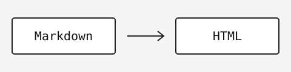

# 중복되면 안 되는 제목

## 코드

```bash
printf 'hello, blog\n'
```

## 표와 이미지

| 구성 | 역할 |
| --- | --- |
| Markdown | 원문 |



### 관련 내용

- 첫 번째 항목
- 두 번째 항목

<script>alert('unsafe')</script>

<a href="javascript:alert(1)" onclick="alert(1)">안전하지 않은 HTML</a>
